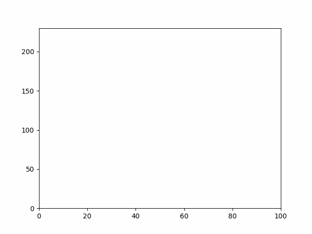
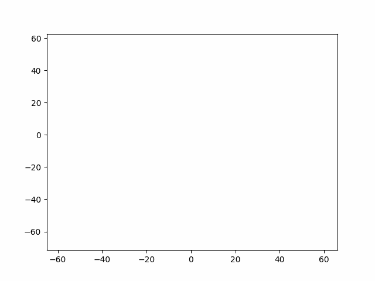

Name: Ivan Wong

UNI: iw2261

This final project implements several different random surface models and analyzes them in their respective Jupyter Notebook. Specifically, the files correspond to:
* ballistic_deposition.ipynb: Ballistic Deposition in 1+1 and 2+1 Dimensions
* eden_model.ipynb: The Eden Model in 2 Dimensions
* DLA.ipynb: Diffusion Limited Aggregation in 2 Dimensions

The following coding resources were used in implementation:
* https://matplotlib.org/stable/users/explain/animations/animations.html
* https://numpy.org/devdocs//reference/generated/numpy.clip.html
* https://docs.scipy.org/doc/scipy/reference/generated/scipy.spatial.distance.cdist.html
* https://stackoverflow.com/questions/43445103/inline-animations-in-jupyter
* https://jakevdp.github.io/PythonDataScienceHandbook/04.12-three-dimensional-plotting.html
* https://stackoverflow.com/questions/71438019/how-do-i-check-if-a-numpy-tuple-is-in-a-2d-numpy-array-of-tuples